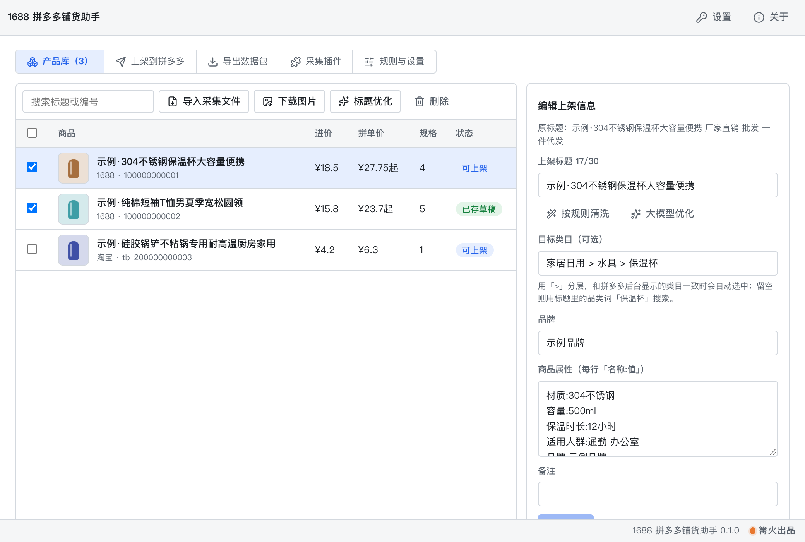

# 1688 拼多多铺货助手

> 篝火出品 · 收录于篝火 App 应用区

## 风险与免责

- **版权风险**：采集他人商品的图片、标题、详情后上架，可能侵犯他人的著作权、商标权或违反平台规则。请先确认你有权使用这些图文（自家货源、已获授权、或自己重新拍摄和撰写）。
- **平台规则风险**：自动操作商家后台可能违反平台的服务协议，账号被限制、处罚的后果由使用者自己承担。工具不会伪装环境，也不会自动处理验证码，遇到登录、扫码、滑块、真人验证需要你自己完成。
- **默认只保存草稿**：「提交上架」默认关闭，要在「规则与设置」里手动打开，并且每件商品提交前都会再弹窗确认。「承诺」类勾选（如正品发票、假一赔十）默认也不勾。
- 拼多多后台页面的操作按页面文字和输入框提示语定位，**尚未用真实商家账号联调**，后台改版后可能失效；失效时会在记录里写明停在哪一步。这部分列入待联调清单。
- 本工具与阿里巴巴、淘宝、天猫、拼多多没有任何关联。

用浏览器插件把 1688、淘宝、天猫的商品采集到本机，整理标题、规格和价格，在拼多多商家后台自动保存草稿，也可以导出 Excel / CSV 上架数据包人工导入。



## 下载

到 [Releases](https://github.com/campfire-code/1688-to-pdd-listing/releases/latest) 下载对应安装包：

| 电脑 | 文件 |
|---|---|
| Windows 10 / 11 | `1688-to-pdd-listing_版本号_windows-x64-setup.exe` |
| Mac（Apple 芯片） | `1688-to-pdd-listing_版本号_mac-arm64.dmg` |
| Mac（Intel 芯片） | `1688-to-pdd-listing_版本号_mac-x64.dmg` |

第一次打开：
- **Windows**：如果弹出「Windows 已保护你的电脑」，点「更多信息」→「仍要运行」。
- **Mac**：如果提示「无法验证开发者」，打开「系统设置 → 隐私与安全性」，在下方点「仍要打开」。

## 怎么用

### 1. 安装采集插件（一次性）

1. 打开应用，进「采集插件」页，点「打开插件文件夹」。
2. 在 Chrome 或 Edge 地址栏输入 `chrome://extensions`（Edge 是 `edge://extensions`），打开「开发者模式」。
3. 点「加载已解压的扩展程序」，选刚才打开的文件夹（里面能看到 `manifest.json`）。
4. 首次可能提示「停用开发者模式的扩展程序」，选保留。

### 2. 采集商品

在浏览器里登录 1688（或淘宝、天猫），打开商品详情页，点插件图标 →「采集当前商品」。应用保持打开，商品会自动出现在「产品库」并下载主图和详情图。应用没开时，插件会先暂存，应用打开后点插件里的「重新发送暂存」。

**数据怎么从插件到应用**：插件把商品 JSON 发到本机 `127.0.0.1:48765`（不经过任何服务器）→ 应用的本机接收服务只接受浏览器插件来源的请求，并要求带插件专用的请求头，先把商品存成收件箱里的一个文件 → 应用入库、下载图片。选这种方式是因为它不需要手动拖文件，又因为先落盘再入库，应用没开或崩溃时也不丢数据。备用方式：「产品库 → 导入采集文件」手动导入插件采集的 JSON。

### 3. 整理商品

在「产品库」里点一件商品，右侧可以改上架标题（可「按规则清洗」去掉批发词，或「大模型优化」）、目标类目（用「>」分层，如 `男装 > T恤 > T恤`）、品牌和属性，并预览规格组合与价格。价格 = 进价 × 系数（默认拼单价 1.5、单买价 1.85，可在「规则与设置」里改）。

大模型（标题优化、问助手）需要你在左侧导航「设置」里填自己的接口地址、密钥和模型名（兼容 OpenAI 接口格式），密钥只保存在本机。

### 4. 上架到拼多多（默认只保存草稿）

1. 进「上架到拼多多」页，点「打开拼多多窗口」，在应用自带的窗口里登录商家后台（登录状态只保存在本应用里，不读取你的 Chrome）。验证码、滑块、扫码由你自己处理，工具会等你。
2. 在「产品库」勾选商品，回到上架页确认每件的检查结果。
3. 点「保存草稿」。工具会选类目、传主图、填标题、品牌、属性、规格和价格库存，然后点「保存草稿」。类目搜不到唯一结果时默认暂停，等你在窗口里自己选好。
4. 到拼多多商家后台的草稿箱核对后，自己提交。

详情图目前不会自动上传到商品详情，请用导出的图片文件夹手动添加。

### 5. 导出上架数据包

进「导出数据包」页，选范围和格式，点「导出到文件夹」。得到：`商品表.xlsx`（「商品」和「规格明细」两个工作表）、可选的 CSV，以及 `images/<商品编号>/` 图片文件夹。商品表的列：商品标题、类目、价格(拼单价)、单买价、库存、主图、详情图、规格、组合明细、描述、商品属性、品牌、重量(kg)、物流模板、进价、来源链接、来源编号、待处理。主图、详情图列写相对 `images/` 的路径，多张用分号隔开。

## 验收用例

样例数据都是虚构的（标题带「示例」），图片是内嵌的小图，不需要联网。

| 操作 | 应得到 |
|---|---|
| 「产品库」→「导入采集文件」→ 选 `samples/示例-插件采集数据.json` | 产品库出现 3 件商品：保温杯（4 个规格，主图 3 张、详情图 2 张）、T 恤（5 个规格）、锅铲（无规格，来自淘宝链接，编号 `tb_200000000003`）；图片全部下载成功，状态为「可上架」 |
| 点保温杯，看右侧「规格与价格预览」 | 规格类型「款式」2 个值（雾面黑、奶油白）、「尺寸」2 个值（500ml、800ml），4 行；进价 18.5 的规格拼单价 27.75、单买价 34.23，库存 100；上架标题为「示例·304不锈钢保温杯大容量便携」（「厂家直销、批发、一件代发」被去掉） |
| 点 T 恤 | 提醒「有 1 个规格组合在 1688 里不存在，已设为库存 0」（白色 + XL）；预览里灰色的行就是补出来的组合，共 6 行 |
| 勾选 3 件，「导出数据包」→ 勾选 Excel 和带图片文件夹 → 导出 | 文件夹里有 `商品表.xlsx`，「商品」表 3 行，拼单价依次为 27.75、23.7、6.3，单买价 34.23、29.23、7.77；「规格明细」表 11 行；`images/100000000001/` 里有 `main_01.png` 到 `main_03.png` 和 `detail_01.png`、`detail_02.png` |
| 「规则与设置」把拼单价系数改成 2 | 保温杯的拼单价变为 37（进价 18.5 × 2） |
| 「上架到拼多多」点「保存草稿」，没有打开拼多多窗口 | 提示「请先点「打开拼多多窗口」，登录商家后台后再开始」 |
| 「规则与设置」里「允许提交上架」保持关闭 | 上架页只有「保存草稿」，没有「提交上架」按钮 |

需要拼多多商家账号的步骤（真实保存草稿）无法用样例验收，用假页面做了流程测试，真实联调列入待联调清单。

## 自己编译

需要 Node.js 22、pnpm、Rust。

```bash
pnpm install
pnpm test          # 单元测试
pnpm tauri dev     # 开发运行
pnpm tauri build   # 打包
```

界面框架在 `src/kit`（所有 campfire-code 工具共用），本工具的逻辑在 `src/tool`。

## 归属

本工具由**篝火**出品，是篝火 App 应用区收录的开源工具之一，由篝火（GitHub 组织 [campfire-code](https://github.com/campfire-code)）维护与更新。全部工具的目录见 [toolkit-hub](https://github.com/campfire-code/toolkit-hub)。

## 许可证

MIT，版权方为篝火（campfire-code）。

上游致谢：见 [THIRD_PARTY_LICENSES.md](THIRD_PARTY_LICENSES.md)。
